<div align="center">

# Canvas Calendar

### A calendar for your whole crew, drawn on an infinite canvas.

**Months float in space. Plans live on days. Arrows connect ideas. And everyone in the group moves in real time.**

[](LICENSE)
[](https://react.dev)
[](tsconfig.json)
[](https://vitejs.dev)
[](https://supabase.com)

**[Feature tour](docs/FEATURE_SHOWCASE.md) · [Groups & invites](docs/GROUPS.md) · [Everything it does](FEATURES.md)**

[Quick start](#quick-start) · [Groups of any size](#groups-of-any-size) · [See it in action](#see-it-in-action) · [How it works](#how-it-works) · [FAQ](#faq) · [Deploy](#run-it-with-your-own-backend)

<code>npm install &amp;&amp; npm run dev</code>

<br />

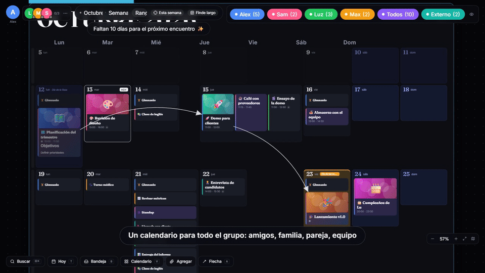

<br /><br />

<table aria-label="Try it">
<tr>
<td align="center" width="420">
  <strong>No account. No backend. No setup.</strong><br />
  <sub>Run the command above, open the app and press <b>“Explorar con datos de ejemplo”</b>.<br />
  Open a second tab as someone else and watch the cursors meet.</sub>
</td>
</tr>
</table>

<br />

</div>

---

A calendar is a grid, and your plans are not. Some weeks are empty, some days are packed, some ideas don't have a date yet, some things depend on other things. Canvas Calendar puts the whole year on **one infinite surface** you can zoom, drag around and rearrange: move months wherever you like, stretch a busy day until its hours appear, draw an arrow from the invitation to the dinner, drop a PDF onto the plan it belongs to.

It started as a calendar for two people and grew into something any group can use: **couples, families, flatmates, friends, small teams**. Everybody sees everybody's cursor, plans are colour-coded by owner, and one link invites the next person in.

Built with AI assistance: I did not write the code by hand. My role was to orchestrate it — define what I needed, test every feature and ask for changes until it worked the way I wanted.

> The interface is in **Spanish** (and ships with Argentine public holidays). Everything is data-driven, so adding a locale is mostly translating strings and swapping `public/feriados/*.json`.

## Quick start

### Try it locally (demo mode)

```bash
git clone https://github.com/NF1323/canvas-calendar.git
cd canvas-calendar
npm install
npm run dev
```

Open the printed URL and choose **Explorar con datos de ejemplo**. Without configuration the app runs in *local mode*: data lives in your browser and syncs between tabs with `BroadcastChannel`. Sign in as a different sample member in each tab (Alex, Sam, Luz, Max) — or add your own with **Unirme al grupo**, there is no member limit.

### Use it with your people

You need a free [Supabase](https://supabase.com) project and any static host. The full walkthrough is in [Run it with your own backend](#run-it-with-your-own-backend) and [`docs/GROUPS.md`](docs/GROUPS.md).

## Groups of any size

| | |
|---|---|
| **Invite by link** | The admin copies a link from *Ajustes → Invitar al grupo*. Whoever opens it creates an account and lands inside the group. The code can be regenerated at any time. |
| **Everyone is visible** | A stack of avatars with a live online counter, one coloured cursor per connected person, an arrow at the edge of the screen pointing to anyone who is off-screen, and *click to follow* anyone's camera. |
| **Colour per person** | Every plan belongs to a member, to **Todos** (the whole group) or to **Externo** (errands, outside friends). Filter chips with live counters let you see just one person's world — or everyone's. |
| **Built not to flood the channel** | Cursor and camera messages are throttled by the number of people online, and nothing is sent when you are alone. See the [scaling notes](docs/GROUPS.md#scaling-notes-honest-numbers). |

## See it in action

<table>
<tr>
<td width="33%" align="center">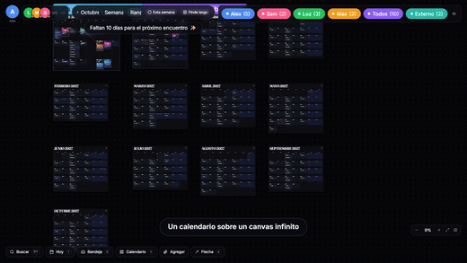<br /><b>Infinite zoom</b><br /><sub>The whole year down to one day.</sub></td>
<td width="33%" align="center">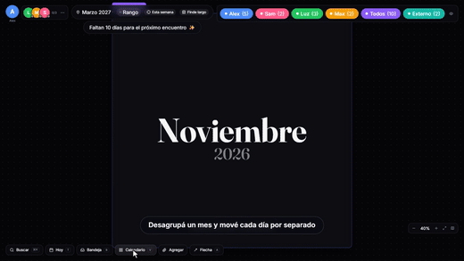<br /><b>Free-form layout</b><br /><sub>Move months, ungroup a month, drag its days.</sub></td>
<td width="33%" align="center">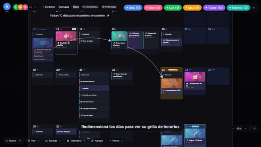<br /><b>Days that open up</b><br /><sub>Stretch a day and its hours appear.</sub></td>
</tr>
<tr>
<td width="33%" align="center">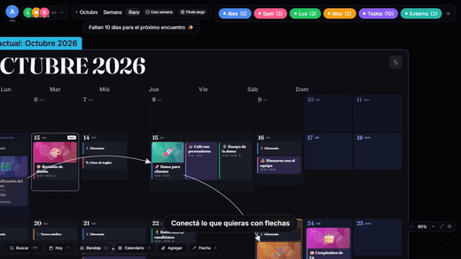<br /><b>Arrows</b><br /><sub>Curved, labelled, they route around months.</sub></td>
<td width="33%" align="center">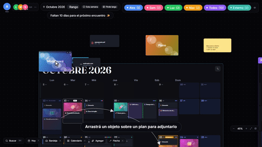<br /><b>Files that stick</b><br /><sub>Drop an image or PDF onto a plan to attach it.</sub></td>
<td width="33%" align="center">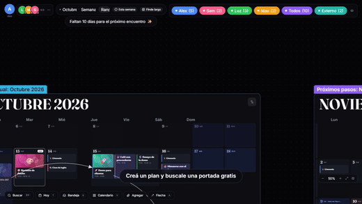<br /><b>Cover search</b><br /><sub>Several free image sources at once.</sub></td>
</tr>
</table>

<div align="center"><b><a href="docs/FEATURE_SHOWCASE.md">All 24 clips, one per feature →</a></b></div>

<br />

<table>
<tr>
<td width="50%">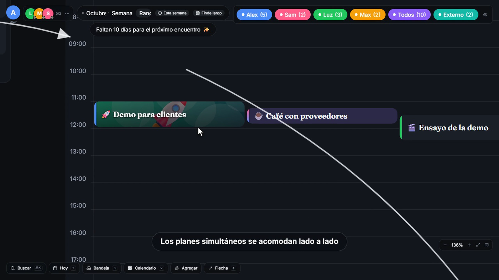</td>
<td width="50%">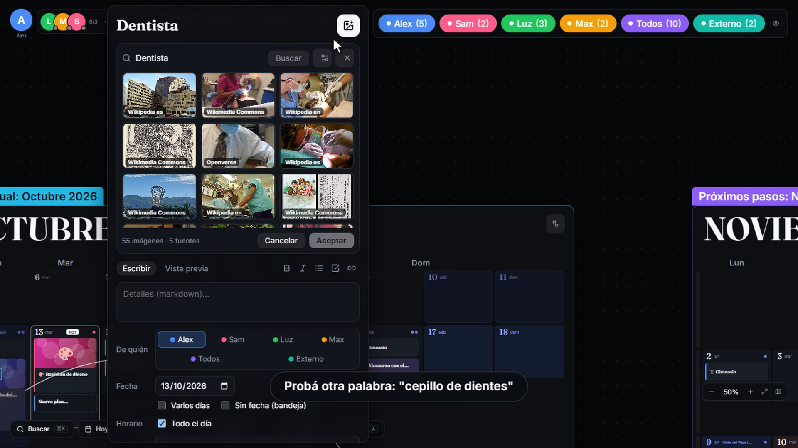</td>
</tr>
<tr>
<td width="50%">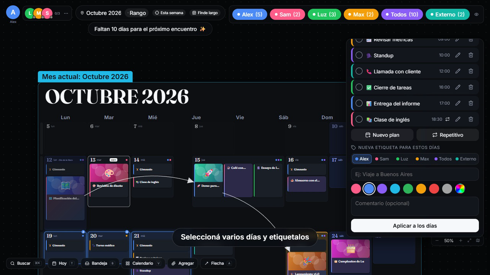</td>
<td width="50%">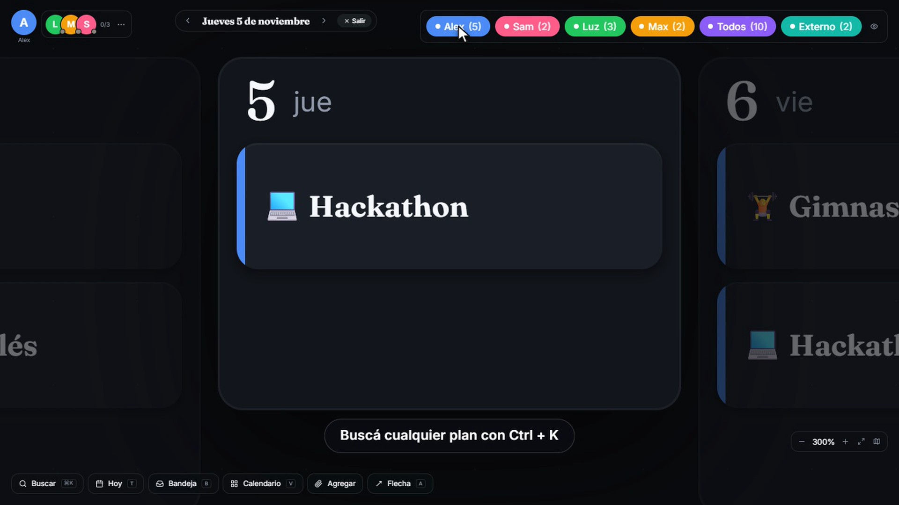</td>
</tr>
</table>

## What you can do

| | What you get | Details |
|---|---|---|
| **Navigate** | Infinite pan/zoom with inertia and pinch, animated flights to *this week* or the *next long weekend*, a minimap, a command palette (`Ctrl + K`). | [clips 1–2, 21, 23](docs/FEATURE_SHOWCASE.md#canvas--navigation) |
| **Arrange** | Move months, ungroup a month to move each day, toggle between *your layout* and a tidy calendar grid (`V`). | [clips 3–5](docs/FEATURE_SHOWCASE.md#free-form-layout) |
| **Plan** | One-off, multi-day and recurring plans, exceptions ("only this one / this and following / all"), overlapping plans side by side, undo/redo, Markdown notes, emoji, covers with a focal point. | [clips 6–8](docs/FEATURE_SHOWCASE.md#resizing-days) |
| **Connect** | Curved arrows between months, days, plans and objects. A tray for plans without a date. Plans that float on the canvas. | [clips 9–12](docs/FEATURE_SHOWCASE.md#connections--loose-plans) |
| **Attach** | Paste or drop images, PDFs, text, links and YouTube onto the canvas; attach them to plans; view and download them. | [clips 13–16](docs/FEATURE_SHOWCASE.md#files--attachments) |
| **Collaborate** | Presence, live cursors, follow mode, shared selection, per-person filters, invite links. | [clip 24](docs/FEATURE_SHOWCASE.md#groups) · [GROUPS.md](docs/GROUPS.md) |

## How it works

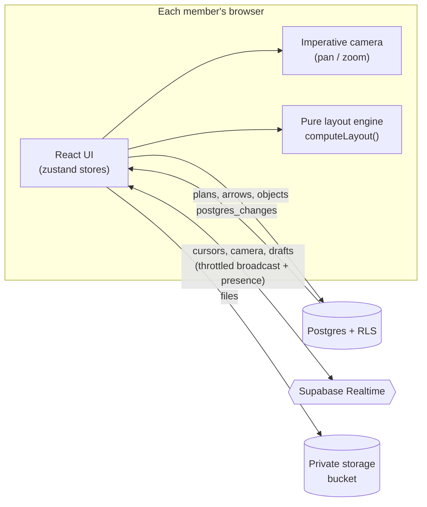

```
src/
  calendar/   pure layout engine, recurrence, the month / day world
  canvas/     camera, gestures (pan, pinch, marquee), drag & resize, navigation flights
  events/     plan card, editor, emoji picker, cover search
  objects/    pasted objects, attachments, PDF / image ingestion
  realtime/   presence, cursors, broadcast (with a BroadcastChannel local mode)
  lib/        data layer (Supabase + local), dates, image processing, demo seed
  ui/         HUD, panels, dialogs, minimap, login
supabase/migrations/   schema + row-level security, versioned in order (0001 … 0010)
```

Design decisions worth knowing:

- **Layout is a pure function of the data** (`computeLayout`), so the canvas, the minimap and the arrows always agree.
- **The camera is imperative, not React state.** Gestures write a CSS transform directly; React only hears about the idle states. That is what keeps panning smooth with a hundred-plus plans on screen.
- **Two data paths, one interface.** `lib/api.ts` serves both Supabase and local mode, so the app is fully usable — and demo-able — without a backend.
- **Security lives in the database.** Every table is protected by row-level security keyed on `is_member()`; the browser only ever holds the public anon key.

## Run it with your own backend

1. Create a Supabase project and run `supabase/migrations/0001_init.sql` … `0010_groups_any_size.sql` in order (SQL editor or the CLI).
2. In **Auth → Users** create your own user and run the block at the bottom of `0010` to make yourself the first member and admin.
3. Put the project URL and the **anon** key in `public/config.js` (never the `service_role` key). `.env.example` shows the equivalent `VITE_*` variables.
4. `npm run build` and deploy `dist/` anywhere that serves static files. `netlify.toml` and `public/_redirects` are included for Netlify.
5. Open the app → *Ajustes → Invitar al grupo* and send the link to your people.

Optional: `0007_keepalive.sql` pings the project every 12 h so a free-tier database never pauses (replace the placeholders first). Free image-search keys (`pexelsKey`, `pixabayKey`, `unsplashKey`, `googleKey` + `googleCx`) can go in `public/config.js` or be pasted in the cover-search panel.

## FAQ

<details>
<summary><b>Is it free to host?</b></summary>

For small groups, yes: Supabase's free tier plus any free static host (Netlify, Cloudflare Pages, GitHub Pages). Check Supabase's Realtime quotas before inviting a very large group — see the [scaling notes](docs/GROUPS.md#scaling-notes-honest-numbers).
</details>

<details>
<summary><b>How many people can use it at once?</b></summary>

There is no hard-coded limit; a group is capped by `max_members` (default 50, configurable up to 500) and by your Supabase plan. It has been run with four simultaneous members in the browser demo and the join flow was tested against a real PostgreSQL engine; it has not been load-tested with dozens of people on a live project. Details in [`docs/GROUPS.md`](docs/GROUPS.md).
</details>

<details>
<summary><b>Can I use it without any backend?</b></summary>

Yes — that is the demo mode. Data stays in one browser (it syncs between its tabs), which is perfect to try it out but not for sharing across devices.
</details>

<details>
<summary><b>Is my group's data private?</b></summary>

Only members can read or write anything: every table has row-level security, uploaded files sit in a private bucket behind signed URLs, and the app only ships the public anon key. Joining requires a valid, regenerable invite code.
</details>

<details>
<summary><b>Does it work on phones?</b></summary>

Touch drag and pinch-zoom are implemented and the interface scales with the viewport, but the canvas is designed desktop-first, so expect the best experience on a laptop or tablet.
</details>

<details>
<summary><b>How much of this was written by AI?</b></summary>

All of the code was written by an AI. My role was that of an orchestrator: defining what the app had to do, testing it in a real browser and requesting changes until it worked as I wanted. You don't need to know how to code to build a tool like this, but you do need clear ideas and concepts from the user's side. The history is a single squashed commit on purpose; the interesting part is the result and the [architecture notes](#how-it-works).
</details>

## Documentation

- [Feature tour — one clip per feature](docs/FEATURE_SHOWCASE.md)
- [Everything it does](FEATURES.md)
- [Groups, invites and scaling](docs/GROUPS.md)
- [`supabase/migrations`](supabase/migrations) — schema and security, in order

## Notes

- Holiday data: `public/feriados/2026.json` comes from the official Argentine government source; `2027.json` is computed from the law.
- Developer hooks (`window.__cam`, `__ui`, `__data`, …) are exposed only in dev builds.

## License

[MIT](LICENSE)
